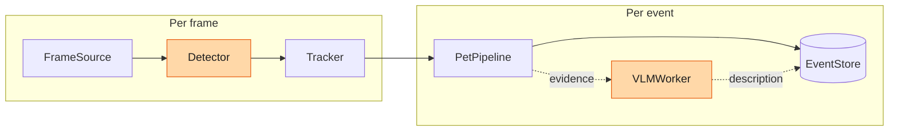
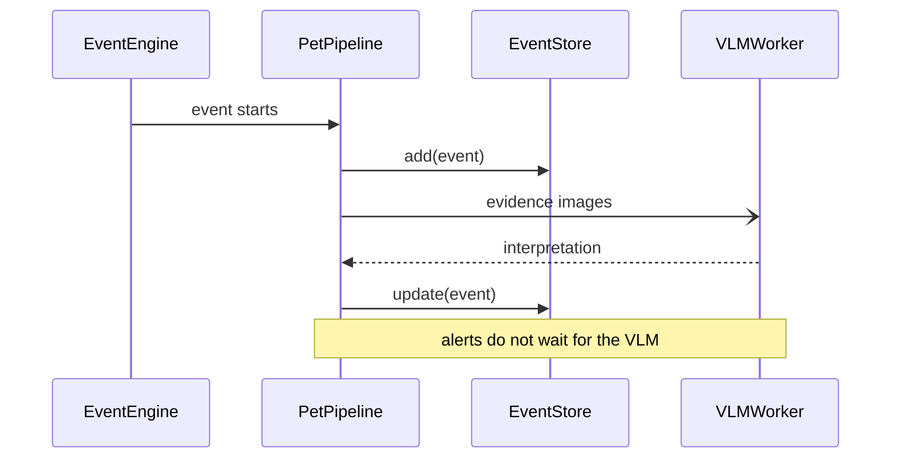
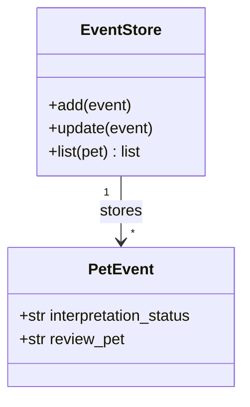
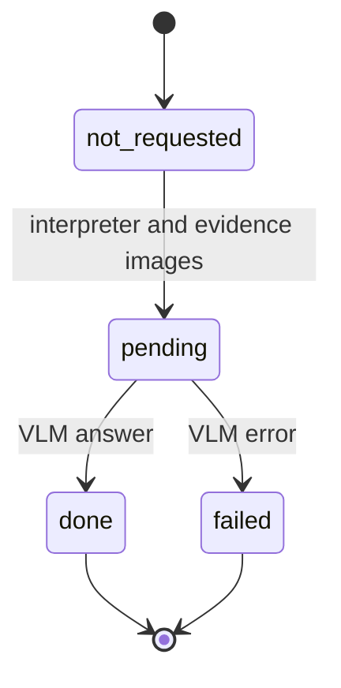
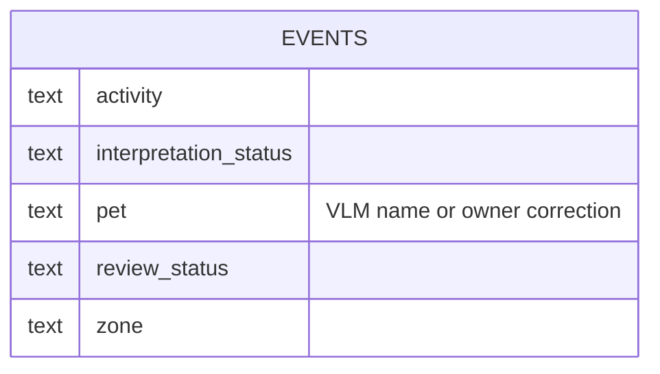
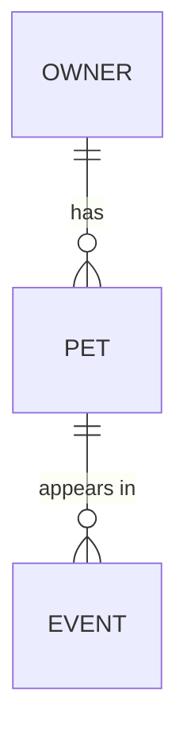
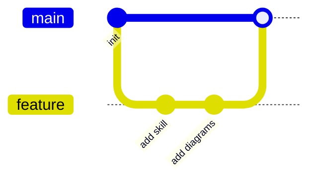
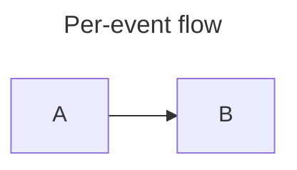

# Mermaid reference (classic syntax)

Every block below is checked with `scripts/check.py`. Names come from this repository where
the text says so; the rest is illustrative. Source of truth:
https://mermaid.js.org/syntax/syntax-reference.html.

## Flowchart: pipeline and boundaries

Orange = needs validation on real hardware or a real model (illustrative subset).

Cheat sheet:

- Direction: `flowchart LR|RL|TD|BT`. `graph` is an alias.
- Shapes: `A[rect]`, `A(rounded)`, `A([stadium])`, `A[(database)]`, `A((circle))`,
  `A{decision}`, `A{{hexagon}}`, `A[[subroutine]]`.
- Links: `A --> B`, `A --- B`, `A -->|text| B`, `A -- text --> B`, `A -.-> B` (dotted),
  `A ==> B` (thick), `A --> B & C`, `A & B --> C`. Extra dashes (`---->`) lengthen a link.
- Subgraph: `subgraph id["Title"]` ... `end`. A `direction` inside a subgraph is ignored when
  one of its nodes links to the outside.
- Style: `classDef name fill:#..,stroke:#..,color:#..`, then `class A,B name` or `A:::name`.
  One-off: `style A fill:#f9f`; edges: `linkStyle 0 stroke:#f00`.
- Comments: `%% text` on its own line.
- Needs Mermaid 11.3+ (avoid on GitHub until confirmed): `A@{ shape: cyl, label: "x" }`.

## Sequence: who calls whom

Simplified from the lab's per-event flow.

- Arrows: `->>` call, `-->>` reply, `-)` asynchronous, `-x` lost. `+`/`-` after the arrow
  activates and deactivates (`A->>+B: ask` / `B-->>-A: answer`).
- Blocks, each closed with `end`: `loop`, `alt` / `else`, `opt`, `par` / `and`, `critical`,
  `break`, `rect rgb(240,240,240)`.
- `autonumber` numbers the messages. `Note right of A: text`, `Note over A,B: text`.
- Aliases: `participant X as Long name`; line breaks in messages with ` `.

## Class: types and relations

Excerpt: members shown are real, many others are omitted.

- Relations: `<|--` inheritance, `*--` composition, `o--` aggregation, `-->` association,
  `..>` dependency, `..|>` realisation. Cardinality in quotes: `A "1" --> "*" B : label`.
- Members: `+public`, `-private`, `#protected`; methods with `()`. `<<interface>>` annotates.

## State: lifecycle of one thing

State names are from `INTERPRETATION_STATES` in `events/model.py`; the arrows are simplified
(`skipped` is omitted).

- Composite states: `state Name { ... }`. Choices: `state c <<choice>>`. Forks: `<<fork>>`.
- Notes: `note right of X : text`. Concurrency: `--` inside a composite state.

## Entity relationship: schema

Excerpt of the lab's `events` columns (see `store/db.py`); `PK`, `FK` and `UK` follow the
column name. Relationship syntax, illustrative:

- Cardinality (outer = maximum, inner = minimum): `||` exactly one, `|o` zero or one,
  `}o` zero or more, `}|` one or more. `--` identifying, `..` non-identifying.
- A relationship needs its `: label`.

## Git graph: branches

`commit`, `branch name`, `checkout name`, `merge name`, `cherry-pick id: "x"`. Tags and
types: `commit tag: "v1" type: HIGHLIGHT`. Orientation: `gitGraph LR:` (default) or `TB:`.

## Front matter and annotations

Front matter must start on the first line of the block. Use `title:` rather than a separate
heading when the diagram is shown alone. Theme and layout keys go under `config:`.
