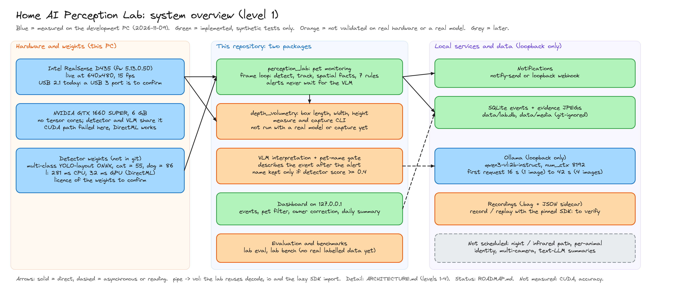
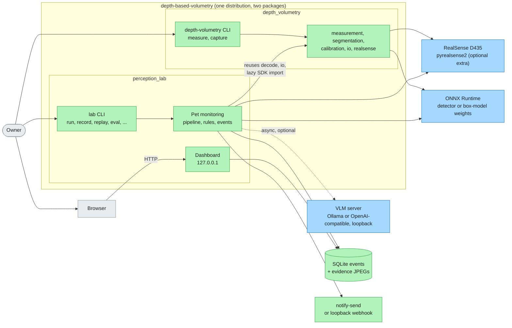

# Architecture

Two packages in one distribution (`pyproject.toml` lists both under
`[tool.uv.build-backend] module-name`). See [ADR 0001](docs/adr/0001-perception-lab-as-sibling-package.md).
This file is the entry point: it gives the system view (level 1), the diagram index and the
rules that hold across the code. The detail is in [`docs/architecture/`](docs/architecture/).

## How to read it

| Step | Document | Level |
|---|---|---|
| 1 | This file | 1: system |
| 2 | [`docs/architecture/lab.md`](docs/architecture/lab.md) | 2-4 for `perception_lab`: data flow, packages and classes, execution |
| 3 | [`docs/architecture/volumetry.md`](docs/architecture/volumetry.md) | 2 for `depth_volumetry` |
| 4 | [`docs/method.md`](docs/method.md), [`docs/pet-monitoring.md`](docs/pet-monitoring.md), [`docs/adr/`](docs/adr/README.md) | geometry, lab design and evaluation, decisions |
| Status | [`ROADMAP.md`](ROADMAP.md) | what is done, measured or planned |

Status words used in the architecture documents:

- **Implemented**: the code exists and is covered by synthetic tests.
- **Measured**: run on real hardware or a real model, with the date and machine in
  [`ROADMAP.md`](ROADMAP.md). Not an accuracy claim.
- **Planned**: not in the code. Listed in the roadmap, never drawn as if it existed.
- **Deprecated**: nothing is deprecated today.

## Diagram index

Mermaid sources are `docs/diagrams/mermaid/*.mmd`, embedded between markers in the documents
(`/mermaid`). Excalidraw diagrams are generated from `docs/diagrams/src/*.py` (`/excalidraw`).

| Level | Diagram | Type | Shows | Where |
|---|---|---|---|---|
| 1 | [overview](docs/diagrams/home-perception-lab-overview.png) | Excalidraw | hardware, weights, the two packages, local services, status colours | here |
| 1 | `l1-system-context` | Mermaid | actors, packages, external systems, communication boundaries | here |
| 2 | `l2-lab-dataflow` | Mermaid | per-frame chain and per-event flow of the lab | [lab.md](docs/architecture/lab.md) |
| 2 | `l2-volumetry-pipeline` | Mermaid | `measure` and `capture` of `depth_volumetry` | [volumetry.md](docs/architecture/volumetry.md) |
| 3 | `l3-lab-package-dependencies` | Mermaid | which lab package imports which, and the reuse points | [lab.md](docs/architecture/lab.md) |
| 3 | `l3-lab-components` | Mermaid | main classes and interfaces of the lab | [lab.md](docs/architecture/lab.md) |
| 3 | `l3-events-schema` | Mermaid | the SQLite `events` table | [lab.md](docs/architecture/lab.md) |
| 4 | `l4-event-lifecycle` | Mermaid | one event from rule hit to stored interpretation | [lab.md](docs/architecture/lab.md) |
| 4 | `l4-vlm-status` | Mermaid | `interpretation_status` transitions | [lab.md](docs/architecture/lab.md) |
| 4 | `l4-rule-event-states` | Mermaid | start, cooldown and release of an event | [lab.md](docs/architecture/lab.md) |
| 4 | `l4-lab-runtime-threads` | Mermaid | threads, locks and where the frame loop blocks | [lab.md](docs/architecture/lab.md) |
| feature | [pet identification](docs/diagrams/pet-identification.png) | Excalidraw | how a pet gets a name, with photos and limits | [pet-monitoring.md](docs/pet-monitoring.md#naming-the-household-pets) |
| status | [roadmap](docs/diagrams/roadmap.png) | Excalidraw | phases and open items | [ROADMAP.md](ROADMAP.md) |

## Level 1: system



The overview shows what runs on which side of the machine; the diagram below shows who
talks to whom. Green boxes are implemented, blue ones are external systems measured on the
development PC, grey ones are outside the repository. Dashed arrows are asynchronous.

<!-- mermaid: docs/diagrams/mermaid/l1-system-context.mmd -->

<!-- /mermaid -->

Responsibilities and boundaries:

- **`depth_volumetry`** turns an aligned colour + depth capture, a calibration and a mask
  into a box's length, width and height. A library and the `depth-volumetry` CLI.
- **`perception_lab`** monitors cats and dogs: detection, tracking, depth-based facts,
  deterministic event rules, an optional VLM description, notifications and a dashboard.
  The `lab` CLI starts everything.
- **External systems** are the RealSense camera and its SDK (optional extra, imported
  lazily), ONNX Runtime with the detector weights, and a VLM server such as Ollama. The
  VLM server, the webhook and the dashboard stay on loopback ([ADR 0004](docs/adr/0004-local-only-loopback-endpoints.md)).
- **Storage** is one SQLite file plus evidence JPEGs under `data/`, which are git-ignored.

## Dependency direction

```
perception_lab  ──imports──▶  depth_volumetry
```

`depth_volumetry` never imports `perception_lab`. The lab reuses exactly three modules:

| From `depth_volumetry` | Used by |
|---|---|
| `segmentation` (`decode_detections`, `nms`, `preprocess`, `xywh_to_xyxy`) | `perception_lab/vision/detector.py` |
| `realsense.load_pyrealsense2` (lazy import) | `perception_lab/sources/realsense.py` |
| `io` (`read_color`, `write_image`) | `perception_lab/eval/bench.py`, `perception_lab/store/media.py`, `perception_lab/cli.py` (lazy) |

## `depth_volumetry`: box measurement

Aligned depth + mask + calibration in, length/width/height out. Geometry, model contract and
calibration procedure: [`docs/method.md`](docs/method.md). Flow diagram:
[`docs/architecture/volumetry.md`](docs/architecture/volumetry.md).

| Module | Role | I/O allowed |
|---|---|---|
| `calibration.py` | `Calibration` dataclass, TOML loading, validation (`CalibrationError`) | reads TOML |
| `measurement.py` | footprint, surface distance, `measure_box` (`MeasurementError`) | no (pure) |
| `segmentation.py` | decode, NMS, mask functions (pure) plus a thin ONNX Runtime wrapper | wrapper only |
| `io.py` | read/write images, depth maps, masks | yes |
| `overlay.py` | annotated output image | no |
| `realsense.py` | optional capture; `pyrealsense2` imported lazily | yes |
| `cli.py` | `measure` and `capture` commands | yes |

## `perception_lab`: pet monitoring

Design, rules, evaluation protocol and privacy defaults: [`docs/pet-monitoring.md`](docs/pet-monitoring.md).
Levels 2-4, with the diagrams: [`docs/architecture/lab.md`](docs/architecture/lab.md).

Per frame (synchronous): `sources` → `vision` (detector, tracker) → `spatial` → track history
→ `events` rules. Per event: `apps/pets/pipeline.py` builds facts and evidence, writes to
`store`, notifies through `notify`, and queues the optional `vlm` worker. `web` serves the
stored events on loopback.

| Package | Role |
|---|---|
| `core/` | shared dataclasses (`FrameBundle`, `Detection`, `SpatialObs`, `TrackObservation`) in `types.py`, TOML config, run record |
| `sources/` | frame sources: RealSense live, `.bag`, video, synthetic scene; `throttle` drops frames instead of queuing |
| `vision/` | YOLO-layout ONNX detector reusing `depth_volumetry.segmentation`, ByteTrack-style tracker, drawing |
| `spatial/` | floor plane (RANSAC), zones (image polygons, optional elevation range), robust per-track depth facts |
| `events/` | features, deterministic rules, start/end hysteresis and cooldowns, event model, evidence ring buffer |
| `vlm/` | strict JSON schema, versioned prompt, Ollama / OpenAI-compatible providers, async worker, pet-name gate |
| `store/` | SQLite history (full-text search, `pet` column, owner corrections, daily per-pet summary), evidence JPEGs, retention |
| `notify/`, `web/` | notifications (`notify-send`, loopback webhook, log) and the standard-library dashboard |
| `eval/` | labels, metrics, repeatable runs, on-machine benchmarks |
| `apps/pets/` | wiring of the above into `PetPipeline` |

## Invariants

- Alerts come from deterministic rules and never wait for the VLM ([ADR 0003](docs/adr/0003-rules-decide-vlm-describes.md)).
- A pet name is the VLM's interpretation, gated on the detector score and correctable by the owner;
  it never drives a rule ([ADR 0006](docs/adr/0006-pet-name-is-a-gated-interpretation.md)).
- Measurement and decode functions are pure; I/O lives in `io.py`, `cli.py`, the model wrapper
  and the lab's `sources/`, `store/`, `web/`, `notify/`.
- The lab is local only; the runtime uses the standard library ([ADR 0002](docs/adr/0002-stdlib-only-lab-runtime.md),
  [ADR 0004](docs/adr/0004-local-only-loopback-endpoints.md)).
- Tests mirror modules: one test module per source module, lab tests in `tests/lab/`.
