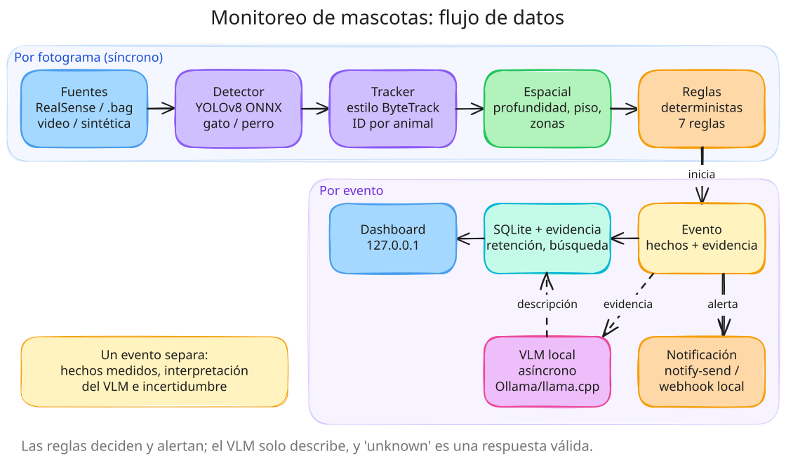

# depth-based-volumetry

Estimate a box's length, width and height from an aligned colour + depth image pair.
A Python library and a small command-line tool.

The repository also contains `perception_lab`, a local-first home perception lab built on
the same RGB-D foundations. Its first application monitors pets; see
[Home perception lab](#home-perception-lab-lab) below.

## How it works

1. **Segment** the box in the colour image, either with your own ONNX instance-segmentation
   model or from a ready-made mask image.
2. **Footprint:** fit an oriented rectangle to the mask; its sides give the box's length and
   width in pixels.
3. **Distance:** average the depth samples under the mask (after discarding invalid values and
   outliers) to get the distance from the camera to the top of the box.
4. **Convert** pixels to centimetres with the pinhole camera model, and get the height from
   the known camera height.

The geometry, the model contract and the calibration procedure are described in
[`docs/method.md`](docs/method.md).

## Requirements

- Python 3.11 or newer.
- One of:
  - an ONNX instance-segmentation model that uses the YOLOv8-seg output layout (no model is
    included), or
  - a binary mask image of the box.
- Optional: an Intel RealSense camera for the `capture` command.

If you train a YOLOv8-seg model with Ultralytics, check that tool's licence (AGPL-3.0)
for obligations that may apply to the model you produce. This project only reads the
model's output tensors and does not depend on Ultralytics.

## Installation

With [uv](https://docs.astral.sh/uv/):

```bash
uv sync                      # create .venv and install the package and dev tools
uv sync --extra realsense    # also install RealSense support
uv tool install .            # install only the command-line tool
```

With pip:

```bash
pip install .
pip install ".[realsense]"
```

## Calibration

Copy [`examples/calibration.example.toml`](examples/calibration.example.toml) and replace the
placeholder values with your own:

| Key | Meaning | Default |
|---|---|---|
| `focal_length_px` | Focal length of the colour camera, in pixels | required |
| `camera_height_cm` | Distance from the camera to the surface the box rests on | required |
| `base_height_cm` | Height of anything between that surface and the box (e.g. a pallet) | `0` |
| `depth_unit_mm` | Millimetres per unit of the depth map (`1` for 16-bit millimetres, `1000` for float metres) | `1` |
| `distance_factor` | Multiplier applied to the measured distance | `1` |
| `depth_percentiles` | Percentile band of depth samples that is averaged | `[20, 80]` |
| `reference_point` | `[x, y]` pixel used to choose among several detections | image centre |

Unknown keys and invalid values are rejected with an explanatory message.

## Usage

Measure a box from a mask image:

```bash
depth-volumetry measure --depth depth.npy --mask mask.png --calibration calibration.toml
```

Measure using a segmentation model, and write an annotated image:

```bash
depth-volumetry measure \
  --color color.png --depth depth.npy --model model.onnx \
  --calibration calibration.toml --overlay annotated.png --json
```

Capture an aligned pair from a RealSense camera (needs the `realsense` extra). The command
also prints the camera's `focal_length_px` and `depth_unit_mm`, ready to paste into your
calibration file:

```bash
depth-volumetry capture --out capture/
```

Options of `measure`:

| Flag | Meaning |
|---|---|
| `--depth PATH` | Depth map aligned to the colour image: `.npy`, or a 16-bit `.png` |
| `--color PATH` | Colour image; required with `--model` and `--overlay` |
| `--model PATH` / `--mask PATH` | Exactly one of: ONNX model, or binary mask image |
| `--calibration PATH` | Calibration TOML file |
| `--overlay PATH` | Write an annotated image |
| `--json` | Print the result as JSON instead of text |
| `--confidence FLOAT` | Minimum detection score with `--model` (default `0.5`) |

Exit codes: `0` success, `1` the box could not be measured (no object, no valid depth,
non-positive height), `2` usage, input or calibration error.

Python API:

```python
from depth_volumetry import measure_box, load_calibration
from depth_volumetry.io import read_depth, read_mask

calibration = load_calibration("calibration.toml")
result = measure_box(read_depth("depth.npy"), read_mask("mask.png"), calibration)
print(result.length_cm, result.width_cm, result.height_cm, result.volume_cm3)
```

## Home perception lab (`lab`)

`lab` monitors cats and dogs with a RealSense camera, entirely on the local machine:
detection and tracking, depth-based facts (distance, elevation above the floor, zones),
deterministic event rules, optional descriptions from a local vision-language model through
Ollama or llama.cpp, desktop notifications and a dashboard on 127.0.0.1. Design, setup,
calibration, the evaluation protocol and limitations are in
[`docs/pet-monitoring.md`](docs/pet-monitoring.md).



The diagram is also available as an editable
[Excalidraw file](docs/diagrams/pet-monitoring-architecture.excalidraw).

Try it without any hardware on the built-in synthetic scene:

```bash
uv run lab run --frames 600
uv run lab eval
```

| Command | Purpose |
|---|---|
| `lab init-config --out lab.toml` | write the default configuration ([`examples/lab.example.toml`](examples/lab.example.toml)) |
| `lab discover` | list RealSense devices, USB type and stream profiles |
| `lab record --seconds S --out F.bag` | record a session (plus a JSON sidecar) |
| `lab replay --source bag --path F.bag` | stream statistics and colour/depth previews (`--preview-dir`) |
| `lab calibrate --out scene.toml` | fit the floor plane, keeping existing zones |
| `lab run [--vlm] [--serve]` | monitor; `--serve` starts the dashboard |
| `lab serve` | dashboard over stored events |
| `lab eval [--labels L.json]` | score a run against labels ([`examples/labels.example.json`](examples/labels.example.json)) |
| `lab bench detector` / `lab bench vlm` | latency, schema validity and GPU memory on this machine |
| `lab purge [--dry-run]` | apply media and event retention |

Most commands take `--config`, `--source`, `--path` and `--frames`. Exit codes: `0`
success, `1` nothing to do (no device, no frames), `2` usage, input or configuration error.

The lab has been tested only with synthetic data, a fake RealSense SDK and a fake VLM
runtime; real-hardware and real-model results must come from your own `lab eval` and
`lab bench` runs.

## Configuration

There are no environment variables. Everything comes from command-line flags, the
calibration file and, for `lab`, the TOML configuration and scene files.

## Development

```bash
uv sync
uv run pytest
uv run ruff check .
uv run ruff format --check .
```

The tests use only synthetic arrays and tensors; they need no network, camera or model.

## Limitations

- One box per measurement.
- The camera must look straight down at a flat base; accuracy depends on the calibration.
- No model is included.
- Inference with a real model and RealSense capture have not been validated on real
  hardware in this repository.
- When no depth sample under the mask is valid, or the computed height is not positive, the
  tool reports an error instead of returning a clamped value.

## Future work

An HTTP API, a Docker image and a calibration helper.

## Licence

[MIT](LICENSE)
