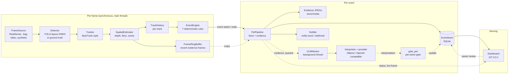
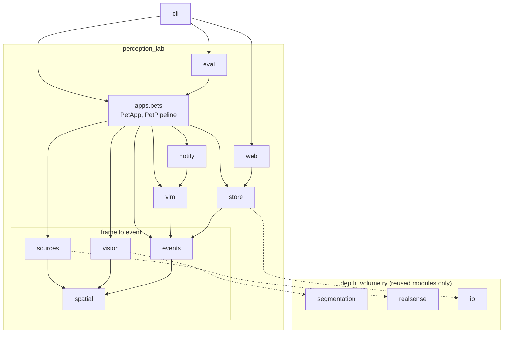
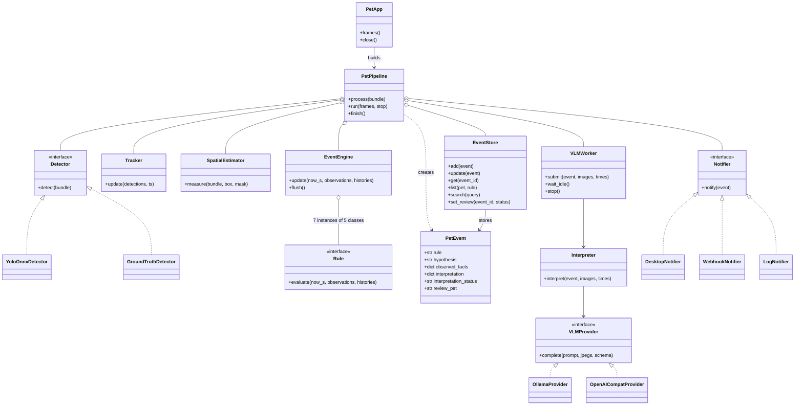
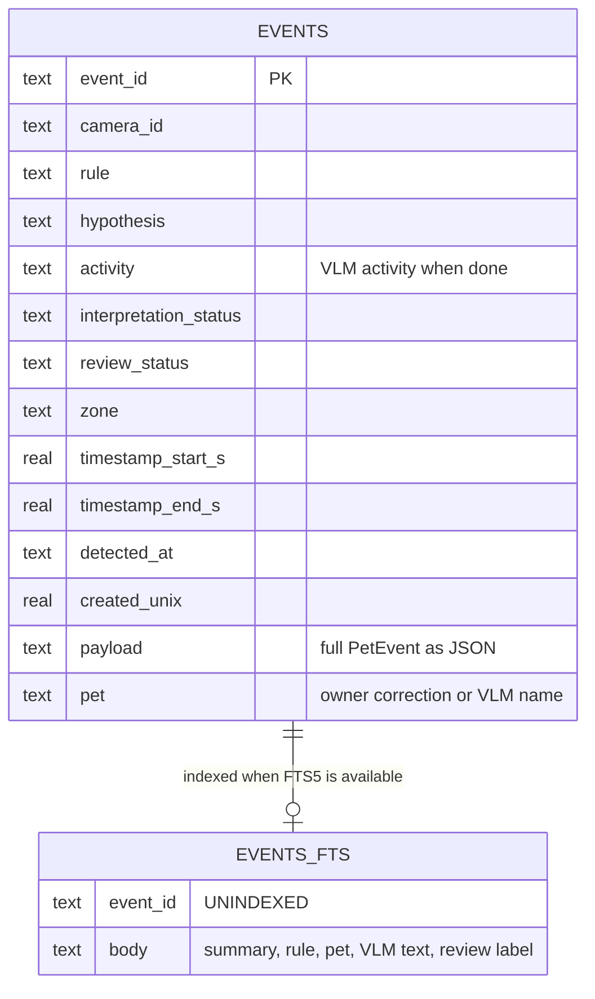
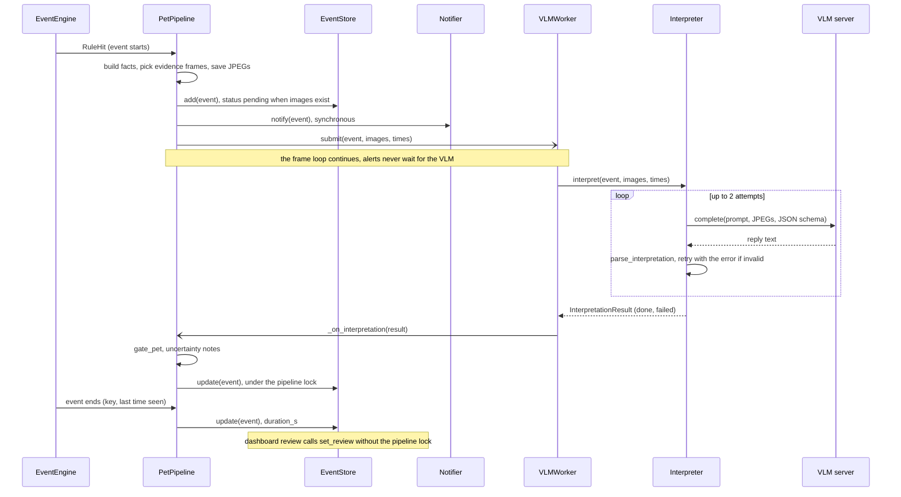
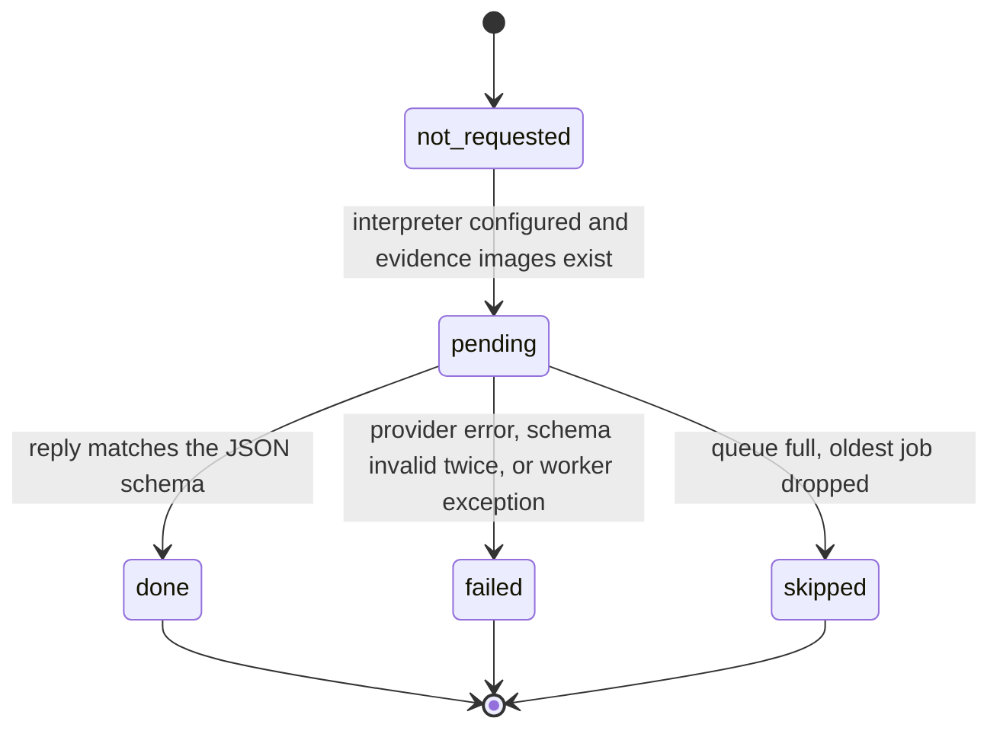
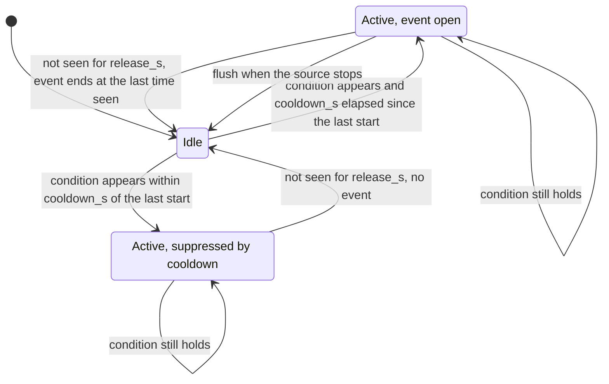
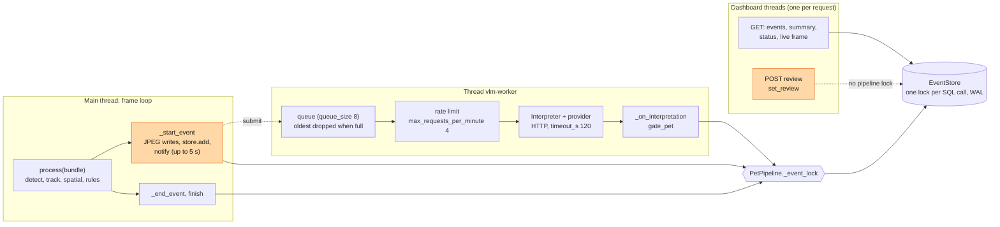

# `perception_lab` architecture

Levels 2 to 4 of the lab, from the data flow down to execution. The system view and the
diagram index are in [`ARCHITECTURE.md`](../../ARCHITECTURE.md); the lab's design, rules,
evaluation protocol and privacy defaults are in [`../pet-monitoring.md`](../pet-monitoring.md).

Everything below describes the code as implemented and covered by synthetic tests. What was
also run on real hardware is in [`ROADMAP.md`](../../ROADMAP.md) with date and machine; none
of it is an accuracy figure. Planned work is listed at the end and never drawn.

## Level 2: data flow

<!-- mermaid: ../diagrams/mermaid/l2-lab-dataflow.mmd -->

<!-- /mermaid -->

**Scope.** The whole lab in one view. Solid arrows are direct calls on the main thread, dotted
ones are asynchronous, queued or user-driven. Alerts come from the rules and never wait for
the VLM; its answer is merged into the stored event afterwards
([ADR 0003](../adr/0003-rules-decide-vlm-describes.md)). An event keeps four things apart:
`observed_facts` (measurements), `hypothesis` (the rule's prior), `interpretation` (the VLM
answer) and `uncertainty` (known reasons to doubt either).

How the parts talk:

| Boundary | Mechanism | Implementation |
|---|---|---|
| Source to pipeline | iterator of `FrameBundle` (colour, aligned depth, intrinsics, timestamp); `throttle` drops frames instead of queuing | [`sources/base.py`](../../src/perception_lab/sources/base.py), [`core/types.py`](../../src/perception_lab/core/types.py) |
| Pipeline to store | `sqlite3`, WAL, one lock around every SQL call; evidence JPEGs under `media_dir/<day>/<event_id>/` | [`store/db.py`](../../src/perception_lab/store/db.py), [`store/media.py`](../../src/perception_lab/store/media.py) |
| Pipeline to notifier | synchronous call; `notify-send` subprocess or webhook POST, 5 s timeout each | [`notify/notifier.py`](../../src/perception_lab/notify/notifier.py) |
| Pipeline to VLM | `VLMWorker` queue (default 8 jobs, oldest dropped), at most 4 requests per minute | [`vlm/interpreter.py`](../../src/perception_lab/vlm/interpreter.py) |
| VLM worker to server | HTTP POST of JSON to a loopback server: Ollama `/api/chat` or an OpenAI-compatible `/v1/chat/completions`; non-loopback needs `allow_remote` | [`vlm/providers.py`](../../src/perception_lab/vlm/providers.py) |
| Dashboard to store | `ThreadingHTTPServer` on a daemon thread, loopback `Host` header required | [`web/server.py`](../../src/perception_lab/web/server.py) |

Dashboard routes (`web/server.py`):

| Method | Path | Purpose |
|---|---|---|
| GET | `/` | the single page |
| GET | `/api/status` | pipeline status |
| GET | `/api/events?limit&offset&rule&pet` | event list, filterable |
| GET | `/api/events/<id>` | one event |
| GET | `/api/search?q=` | full-text search |
| GET | `/api/summary?date=` | per-pet daily summary |
| GET | `/api/pets` | configured pet names |
| GET | `/api/zones` | zones of the scene |
| GET | `/api/live.jpg` | latest annotated frame |
| GET | `/media/<path>` | evidence image, path-traversal safe |
| POST | `/api/events/<id>/review` | owner review: `status`, optional `label` and `pet` |

The `lab` commands and their flags are in the [README](../../README.md#home-perception-lab-lab).

## Level 3: components

### Package dependencies

<!-- mermaid: ../diagrams/mermaid/l3-lab-package-dependencies.mmd -->

<!-- /mermaid -->

**Scope.** Imports between lab packages, taken from the source. Every package except `store`
also imports `core` (config and shared types); those edges are left out. Dotted arrows are the
reuse points of `depth_volumetry` (the three modules in `ARCHITECTURE.md`).

Left out for readability: `cli` also imports `sources`, `spatial`, `store`, `eval` and
`depth_volumetry.io` directly (lazily, for `record`, `calibrate`, `summary`, `purge` and
`bench`), and `eval` also imports `sources`, `vision`, `events`, `vlm` and
`depth_volumetry.io` for the benchmarks. The drawn arrows are the ones that carry the
architecture; none of the omitted ones points upward.

Two dependencies cross layers on purpose: `notify` reuses the HTTP helper and loopback check of
`vlm.providers`, and `events.rules` and `vision.draw` read the zone model from `spatial.scene`.

### Classes and interfaces

<!-- mermaid: ../diagrams/mermaid/l3-lab-components.mmd -->

<!-- /mermaid -->

**Scope.** The classes that carry the behaviour; helpers and dataclasses other than `PetEvent`
are omitted. `Detector`, `Rule`, `Notifier` and `VLMProvider` are `Protocol`s, so a new
implementation needs no registration beyond its factory.
`gate_pet` (a function in [`vlm/interpreter.py`](../../src/perception_lab/vlm/interpreter.py))
is applied by the pipeline when an interpretation arrives.

The seven rules are instances of five classes
([`events/rules.py`](../../src/perception_lab/events/rules.py), `default_rules`):

| Rule | Class |
|---|---|
| `zone_entry`, `zone_dwell` | `ZoneRule` |
| `elevated_surface` | `ElevatedRule` |
| `stationary`, `long_inactivity` | `StationaryRule` |
| `speed_burst` | `SpeedBurstRule` |
| `proximity` | `ProximityRule` |

Expected difficulty per rule is in [`../pet-monitoring.md`](../pet-monitoring.md#rules-and-expected-difficulty).

### Event table

<!-- mermaid: ../diagrams/mermaid/l3-events-schema.mmd -->

<!-- /mermaid -->

**Scope.** The one SQLite table. `payload` holds the whole `PetEvent` as JSON; the other
columns exist for filtering and ordering. Indexes: `events_created`, `events_rule`,
`events_pet`. `events_fts` exists only when SQLite has FTS5. The `pet` column was added later:
`EventStore._add_pet_column` adds it to an older database and backfills it from `payload`
(and from the owner correction), so existing files keep working
([`store/db.py`](../../src/perception_lab/store/db.py)).

## Level 4: execution

### One event, start to finish

<!-- mermaid: ../diagrams/mermaid/l4-event-lifecycle.mmd -->

<!-- /mermaid -->

**Scope.** The path of one event through [`apps/pets/pipeline.py`](../../src/perception_lab/apps/pets/pipeline.py).
The event is stored and notified before the VLM is asked. The VLM answer comes back through
`_on_interpretation`, which applies `gate_pet` and writes under the pipeline's event lock.
`gate_pet` replaces the pet name with `unknown` (keeping the original as `pet_vlm`) when there
is no detector score, the score is below `vlm.pet_min_detector_score`, or the VLM's certainty is
`low` ([ADR 0006](../adr/0006-pet-name-is-a-gated-interpretation.md)). In evaluation runs the
worker is replaced by an inline call.

### Interpretation status

<!-- mermaid: ../diagrams/mermaid/l4-vlm-status.mmd -->

<!-- /mermaid -->

**Scope.** The values of `interpretation_status`, assigned in
[`events/model.py`](../../src/perception_lab/events/model.py) (default),
[`pipeline.py`](../../src/perception_lab/apps/pets/pipeline.py) (`pending`, then the
result's status) and [`vlm/interpreter.py`](../../src/perception_lab/vlm/interpreter.py)
(`done`, `failed`, `skipped`). A provider error fails at once; an invalid reply is retried once
with the validation error appended, then fails. A non-`done` result is stored as
`interpretation = {error, raw_text}` with a note in `uncertainty`. `Interpreter.interpret` also
returns `skipped` when it is given no images, but the pipeline only submits an event that has
evidence, so through the pipeline `skipped` means the queue was full.

### Event start, cooldown and release

<!-- mermaid: ../diagrams/mermaid/l4-rule-event-states.mmd -->

<!-- /mermaid -->

**Scope.** What [`events/engine.py`](../../src/perception_lab/events/engine.py) does for each
rule key `(rule, track ids, zone)`. There is no explicit state machine in the code: the states
above are derived from three dictionaries (`_last_true`, `_open`, `_last_fired`). The cooldown
is measured from the start of the previous event, not from its end.

### Threads and locks

<!-- mermaid: ../diagrams/mermaid/l4-lab-runtime-threads.mmd -->

<!-- /mermaid -->

**Scope.** Who runs where. The frame loop, the notifier, the JPEG writes and SQLite are on the
main thread; the VLM worker and the dashboard have their own threads. `EventStore` locks every
SQL call, and `PetPipeline._event_lock` covers the read-modify-write of one event. Orange boxes
are the two places discussed under known gaps.

### Errors

- Invalid configuration, a missing source, an unreachable device or a non-loopback endpoint
  raise `ConfigError`, `SourceError`, `SpatialError` or `ProviderError`; `lab` prints the
  message and exits with 2.
- VLM failures never propagate: they become a status (above).
- A failing notifier is logged and skipped.
- The dashboard answers 404 for an unknown event and 400 for a bad request.

A feature view that follows one pet name through these steps, with photos and measured limits,
is [`pet-identification.png`](../diagrams/pet-identification.png).

## Implemented, measured, planned

| State | What |
|---|---|
| Implemented | everything drawn above, covered by synthetic tests |
| Measured | on the Windows development PC (see the roadmap for dates and numbers): live D435 capture, detector latency on CPU and DirectML, VLM latency, a live black cat |
| Planned | night or infrared path, per-animal identity (track ids are not identities), multi-camera, text-LLM summaries, a gallery update command |
| Deprecated | nothing |

## Known gaps in the implementation

Found while documenting; none is fixed here and none changes a diagram's meaning.

- **The frame loop blocks** on notifications (5 s timeout each), JPEG writes and SQLite commits.
- **A review can lose a write.** `EventStore.set_review` does not take `PetPipeline._event_lock`,
  so an owner review at the same moment as a VLM result or an event end can overwrite it.
- **Unused settings and constants.** `RulesConfig.speed_window_s` is defined and in the example
  config but never read (`SpeedBurstRule` uses `speed_burst_min_s`); `INTERPRETATION_STATES` is
  defined but not used for validation.
- **The default detector is `ground_truth`**, which only works with the synthetic source: it
  raises `ValueError` for frames without ground truth, so a video or camera source needs
  `detector.kind = "yolov8_onnx"` first.
- **Retention is split.** Evidence folders are removed after `media_retention_days` (14 by
  default) while rows are kept for `event_retention_days` (365), so older events keep evidence
  paths whose files are gone.
