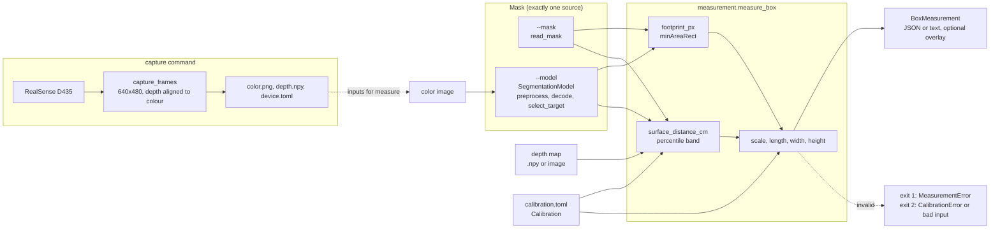

# `depth_volumetry` architecture

Level 2 of the box-measurement package. The system view is in
[`ARCHITECTURE.md`](../../ARCHITECTURE.md); the geometry, the segmentation model contract and
the calibration procedure are in [`../method.md`](../method.md) and are not repeated here.

Status: implemented and covered by synthetic tests. It has not been run with a real
segmentation model or a RealSense capture through this CLI (see [`ROADMAP.md`](../../ROADMAP.md)).

## Data flow

<!-- mermaid: ../diagrams/mermaid/l2-volumetry-pipeline.mmd -->

<!-- /mermaid -->

**Scope.** What `depth-volumetry measure` does ([`cli.py`](../../src/depth_volumetry/cli.py),
`_run_measure`) and what `capture` produces for it. The mask comes from exactly one source: a
mask file, or a model (`--model`), which needs the colour image. The measurement itself
([`measurement.py`](../../src/depth_volumetry/measurement.py)) is pure: it takes the mask, the
depth map and the `Calibration`, and returns a `BoxMeasurement`.

The modules and their I/O rules are in the table of `ARCHITECTURE.md`. Only `cli.py`,
`io.py`, `realsense.py` and the model wrapper in `segmentation.py` touch files, the camera or
the runtime.

## Errors

| Error | Raised when | Exit code |
|---|---|---|
| `CalibrationError` (a `ValueError`) | the calibration file is missing, malformed, has unknown or missing keys, or a value is invalid ([`calibration.py`](../../src/depth_volumetry/calibration.py)) | 2 |
| `MeasurementError` | the mask is empty, no valid depth falls in the mask, the computed height is not positive, or the model finds nothing to select | 1 |
| input errors (`ValueError`, missing files, a colour image without `--model`) | bad arguments or inputs | 2 |

Nothing is clamped or substituted: an invalid input raises. The lab reuses three modules of
this package; see the dependency table in `ARCHITECTURE.md`.
