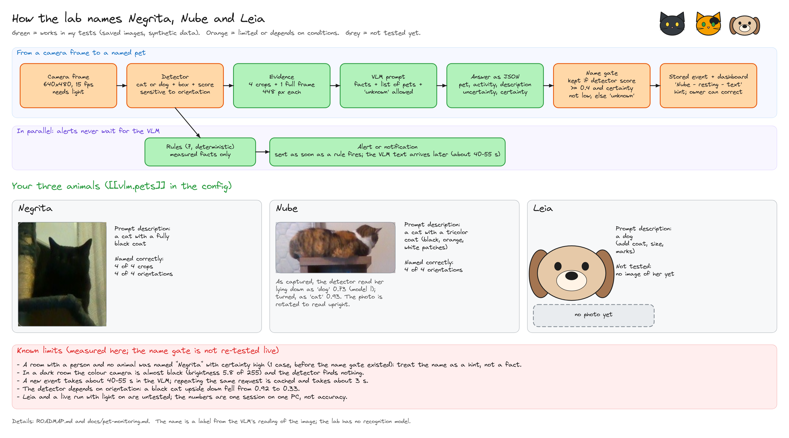

# Pet activity monitoring (`perception_lab`)

Local-first monitoring of cats and dogs with an Intel RealSense camera: detection, tracking,
depth-based spatial facts, deterministic event rules, optional descriptions from a small
local vision-language model (VLM), local notifications and a local dashboard. Everything
runs on one machine; nothing is sent to a cloud service.

**Status.** The pipeline is implemented and covered by synthetic tests (a synthetic scene, a
fake RealSense SDK and a fake VLM runtime). Live capture, detector and VLM latency and a live
cat were also run on the Windows development PC on 2026-11-09; see [`ROADMAP.md`](../ROADMAP.md)
for what was measured and what was not. Nothing here is a real-world accuracy measurement:
every accuracy figure must come from your own runs (`lab eval`, `lab bench`).

## Architecture

The structure is documented in [`ARCHITECTURE.md`](../ARCHITECTURE.md) (system view and the
package table) and [`architecture/lab.md`](architecture/lab.md) (data flow, components and
execution, with diagrams). The rules below are the design principles behind it.

Design rules:

- **Rules decide, the VLM describes.** Events and notifications come from deterministic
  rules over measured facts. The VLM is asked only after an event starts, receives a few
  evidence crops plus the measured facts, and its answer is merged later.
- **Facts, interpretation and uncertainty are separate fields.** `observed_facts` holds
  measurements, `hypothesis` the rule's prior (e.g. a dwell at the food bowl suggests
  `eating`), `interpretation` the VLM answer, and `uncertainty` known reasons to doubt
  either. `unknown` is a valid VLM answer. `confidence` stays empty until it can be
  calibrated against reviewed events.
- **No silent substitution.** Missing depth gives `None` plus a quality flag; speeds and
  distances say whether they are in metres or body lengths.

## Rules and expected difficulty

| Behaviour | Rule (`rule` → `hypothesis`) | Main signal | Difficulty |
|---|---|---|---|
| Entering a restricted area | `zone_entry` → `entered_restricted_area` | foot point in a `restricted` zone | easy |
| On furniture or counter | `elevated_surface` → `on_elevated_surface` | elevation above the floor, or an `elevated` zone | easy–medium (needs floor calibration) |
| Running | `speed_burst` → `running` | mean speed over 1 s | easy–medium |
| Resting / sleeping | `stationary` → `resting_or_sleeping` | stillness outside dwell zones | medium; sleep vs rest is not visually decidable |
| Eating / drinking | `zone_dwell` → `eating` / `drinking` | dwell in a `food` / `water` zone; VLM to separate eating from sniffing | medium–hard |
| Animals interacting | `proximity` → `interacting` | two animals within 0.5 m | medium; play vs conflict needs the VLM and is unreliable |
| Unusual inactivity | `long_inactivity` → `unusual_inactivity` | stillness for an hour | needs per-animal baselines; not validated |
| Playing, grooming | VLM only (`playing`, `grooming`) | — | hard; expect `unknown` |

Repeated movement patterns and per-animal identity are not implemented.

## What depth adds, and how far to trust it

| Measurement | Reliability | Conditions |
|---|---|---|
| Distance to the animal | usable at room distances, with `depth_valid_ratio` | stereo depth error grows with distance; dark or fluffy fur, sunlight and motion leave holes |
| 3D position | usable | median over the shrunk box or mask; biased towards background on loose boxes |
| Zones | reliable after calibration | per camera; redo `lab calibrate` if the camera moves |
| Elevation / jumping | controlled conditions only | needs the floor plane; treat as floor / furniture / counter, not centimetres |
| Proximity between animals | reliable at coarse thresholds | 2D box overlap is not proximity; depth separates them |
| Object moved or missing | reliable for rigid static objects | not part of this app yet (see `depth_volumetry` for box measurement) |
| Room mapping | single-view floor plane only | multi-view mapping is out of scope |
| Animal size or volume | not reliable | not used |

Depth is never used as evidence of identity or behaviour on its own.

## First steps on the target machine

Run these on the machine with the camera and GPU (the first runs were on a Windows PC, see
[`ROADMAP.md`](../ROADMAP.md); the Ubuntu and CUDA path is untested) and keep the outputs;
they replace every assumption in this document.

```bash
nvidia-smi
```

```bash
uv sync --extra realsense
```

```bash
uv run lab discover
```

`lab discover` lists the camera model, firmware, USB type and supported profiles. The
`realsense` extra is pinned to `pyrealsense2` below 2.56 and the project runs on Python 3.11:
version 2.59.1 records only `.db3` files and replays them with all-zero aligned depth, while
2.55.1 records and replays `.bag` files correctly. 2.55.1 has no wheel for Python 3.12 or later,
so `uv sync --extra realsense` fails there; use the Python in `.python-version`.

Record a few minutes and check the streams:

```bash
uv run lab record --seconds 120 --out data/recordings/first.bag
```

```bash
uv run lab replay --source bag --path data/recordings/first.bag --preview-dir outputs/preview
```

### VLM runtime

Install [Ollama](https://ollama.com) (or llama.cpp `llama-server`) locally and pull the
smallest candidate first. The configured default is `qwen3-vl:2b-instruct` (listed in the
Ollama library on 2026-11-09). The plain `qwen3-vl:2b` tag is the reasoning variant, which was
slow and often cut its answers on this machine.

```bash
ollama pull qwen3-vl:2b-instruct
```

```bash
uv run lab bench vlm --images 1,3,6 --repeats 3 --out outputs/bench/vlm-2b.json
```

```bash
uv run lab bench vlm --images 1,3 --montage --out outputs/bench/vlm-2b-montage.json
```

The benchmark reports, per image count: latency percentiles, how many answers matched the
schema, the answers, errors, peak GPU memory (whole GPU, via `nvidia-smi`) and Ollama's own
`size_vram`. Repeat with the 4B quantised model (`--model <tag>`). Decide from these
numbers, not from model file sizes:

- if answers come back empty or cut, check `vlm.num_ctx` (default 8192) before blaming the
  model: the prompt costs about 1100 tokens per image and Ollama's own default of 4096 tokens
  is exhausted by three images. `num_ctx` applies to Ollama only; set the context of
  `llama-server` when you start it;
- prefer a non-reasoning tag such as `qwen3-vl:2b-instruct` over the plain `2b` tag, which is
  the reasoning variant and spends tokens thinking before the JSON;
- Ollama caches the prompt prefix, so repeating one request makes it look fast; the first
  request with new images is the one that matters for latency;
- if multi-image requests fail or are ignored, set `vlm.montage = true`;
- keep the model whose peak memory leaves room for the detector (6 GB card) and whose
  latency is acceptable; alerts never wait for the VLM;
- check the model licence on its official model card before relying on it.

### Naming the household pets

List the animals in `[[vlm.pets]]` (name, species, a description of visible features such as
the coat; see `examples/lab.example.toml`). With at least one entry the prompt lists them, the
schema requires a short `pet` value, and the answer must be one of the configured names or
`unknown` (prompt version `pets_v1+pet`). Without entries nothing changes. The value is stored
in `interpretation`, next to the activity: it is the model's reading of the image, not a
measurement, and the lab has no recognition model. It adds about 80 prompt tokens and a few
output tokens per request.

The path from a camera frame to a named pet, the three animals and the known limits are
drawn in `docs/diagrams/pet-identification.png` (editable source:
`docs/diagrams/pet-identification.excalidraw`, with the gallery photos embedded):



Three safeguards follow from the failure below ([ADR 0006](adr/0006-pet-name-is-a-gated-interpretation.md)):

- **Gate.** The event's mean detector score is stored as `observed_facts.detector_score_mean`.
  The name is kept only if it reaches `vlm.pet_min_detector_score` (0.4 by default) and the
  VLM's certainty is not `low`; otherwise `pet` becomes `unknown`, the raw answer stays in
  `pet_vlm` and the reason is added to `uncertainty`. The threshold is a first guess, not tuned.
- **Owner correction.** With pets configured, each event in the dashboard has a "correct pet"
  selector. The correction is stored as `review_pet`, wins over the VLM and is what the `pet`
  column, the filter and the summary use. Corrected events are the labels for measuring the
  naming later.
- **Filter and summary.** The dashboard filters events by pet (`/api/events?pet=`), and
  `lab summary [--date YYYY-MM-DD]` (also `/api/summary` and the "Today per pet" block) counts
  events and seconds per pet and activity from SQLite, saying how many activities came from
  the VLM and how many from the rule alone. Names that were not asked for appear as `unnamed`.
  An existing database gets the `pet` column on open.

What was checked (2026-11-09, `qwen3-vl:2b-instruct`, saved crops, through the lab's own
code, before the gate existed): a black cat named correctly from four crops, a tricolor cat named correctly from one
crop, and a room with no animal named as a pet with certainty `high`. So the value can be wrong
when the detection itself is wrong, and `certainty` does not warn about it; treat `pet` as a
hint and keep the detector score next to it. A dog was not tested (no image), and the
descriptions of the animals decide how well the cats are told apart.

### Detector

Export a COCO-trained detector with the YOLOv8 output layout to ONNX (detection or
segmentation; segmentation masks improve depth sampling) and measure it:

```bash
uv run lab bench detector --source bag --path data/recordings/first.bag --frames 200
```

`detector.class_ids` must match the model's own class list: the defaults (15 and 16) are the
COCO ids of cat and dog, and a model with another vocabulary silently selects other classes
(a model with a much larger vocabulary was checked here: cat = 55 and dog = 86, and ids 15
and 16 were two unrelated classes). Read the names from the exported file before configuring it:

```bash
uv run python -c "import ast, onnxruntime as ort; s = ort.InferenceSession('model.onnx'); print(ast.literal_eval(s.get_modelmeta().custom_metadata_map['names']))"
```

Models whose export has a different output layout (for example end-to-end, NMS-free outputs)
are not decoded by the lab; export with the YOLOv8 layout (`end2end=False` in Ultralytics).

Ultralytics weights are AGPL-3.0; check the licence of whatever weights you use. Set
`detector.kind = "yolov8_onnx"` and `detector.model_path` in `lab.toml`.

The base dependency `onnxruntime` is the CPU build, and `providers_in_use` in the benchmark
output shows what actually ran. GPU inference needs `onnxruntime-gpu` in its place, matched
to the installed CUDA and cuDNN versions; that is a dependency change to make and lock on
the target machine. On a 6 GB card, compare the detector on CPU against GPU while the VLM is
loaded before choosing.

### Calibration and zones

1. With the floor visible and mostly clear, fit the floor plane:

   ```bash
   uv run lab calibrate --source realsense --out scene.toml
   ```

   It prints the camera height above the floor and its tilt; check them with a tape.
2. Start monitoring with the dashboard, click points on the live view and paste the
   generated `[[zones]]` snippets into `scene.toml`. Tags: `food`, `water`, `bed`
   (dwell rules), `restricted` (entry rule), `elevated` (raised surface without depth).
3. Set `spatial.scene_path = "scene.toml"` in `lab.toml`.

### Monitoring

```bash
uv run lab init-config --out lab.toml
```

```bash
uv run lab run --config lab.toml --source realsense --vlm --serve
```

The dashboard is at http://127.0.0.1:8000/. Use **Correct** / **Wrong** on events: reviews
are stored and become labels for calibration later.

## Evaluation protocol

### Dataset

- 15–25 recording sessions (`.bag`) of 5–30 minutes: each animal alone, animals together,
  feeding times, rest periods, daylight, artificial light, night/IR.
- Several hours of ordinary activity without labelled events, to measure false events per
  day.
- Labels as JSON (see `examples/labels.example.json`): activity, start and end in seconds
  from the first frame, animal class. Commit labels if useful, never the recordings.

### Splits without leakage

Frames of one session are strongly correlated, so split **by session**, never by frame or
clip. Keep at least one whole day and one night session only in the test split. Roughly
60/20/20 sessions for train/validation/test; tune thresholds and prompts on validation
only; evaluate on test only for milestone reports, with the configuration frozen.

### Procedure

```bash
uv run lab eval --config lab.toml --source bag --path data/recordings/val-01.bag --labels data/labels/val-01.json
```

Each run writes `outputs/runs/<run-id>/` with `run.json` (code revision, packages, config,
model and labels hashes), `metrics.json`, `events.jsonl` and `report.md`:

| Metric | Definition |
|---|---|
| Event precision / recall / F1 | per activity; a prediction matches a segment with the same activity and compatible animal class whose interval, widened by the tolerance, overlaps it (one-to-one) |
| False events per day | unmatched rule events per day of recording |
| VLM accuracy when answered | correct answers among non-`unknown` answers, against the overlapping labelled segment |
| Unknown rate | `unknown` answers among all answers |
| Detection precision / recall, identity switches | when frames carry ground-truth boxes (synthetic source) |
| Latency, throughput, memory | `stage_ms` in the run, `lab bench` |

Compare runs that differ in one thing only: detector, input size, VLM model, prompt
version, number of frames, crops vs montage.

The synthetic source has built-in labels (`lab eval` without `--labels`). It checks the
plumbing and robustness to controlled detector noise (`detector.gt_miss_rate`,
`detector.gt_jitter_px`); it says nothing about real-world accuracy. Its cat rests for about
a minute, so with the default `rules.stationary_s = 300` that rest is (correctly) reported
as missed; set `stationary_s = 30` to exercise the rule.

## Privacy and retention

- No continuous recording: frames live in a short in-memory ring buffer; only evidence for
  events is written to disk.
- Defaults: evidence images 14 days, event rows 365 days (`lab purge`, also `--dry-run`).
- The dashboard binds to 127.0.0.1 and refuses other addresses unless
  `web.allow_remote = true`; it has no authentication.
- VLM and webhook endpoints must be loopback unless explicitly allowed.
- Recordings, databases, media, models and calibration files are git-ignored.

## Known limitations

- Only partly validated on real hardware: a live capture, detector and VLM latency and one
  live cat were run on 2026-11-09 (see [`ROADMAP.md`](../ROADMAP.md)); there is no labelled
  real data, so no accuracy figure exists.
- One camera; multi-camera fusion is not implemented.
- Track ids are not animal identities; identity can switch when animals overlap.
- Under heavy detector noise (synthetic: 40 % missed detections, 8 px jitter) the
  `interacting` rule is missed.
- `unusual_inactivity` uses a fixed threshold, not learned per-animal baselines.
- The zone editor only produces TOML snippets; zones are edited in `scene.toml`.
